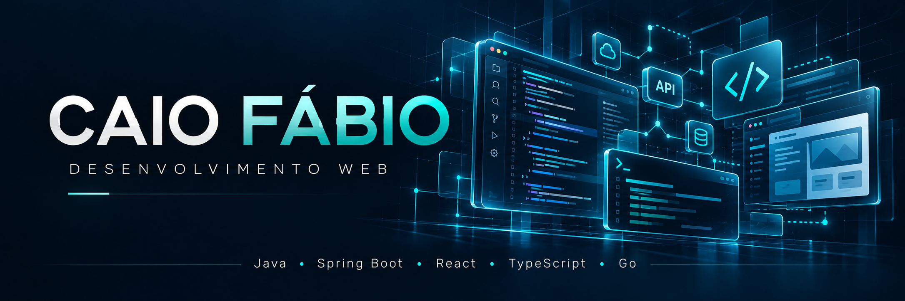
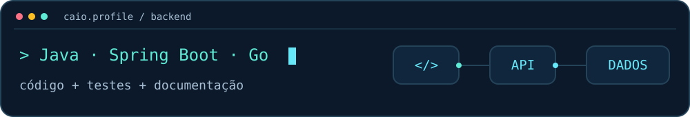
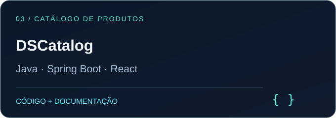
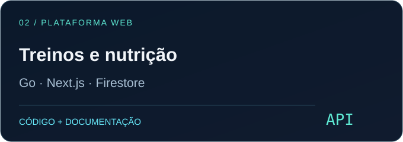
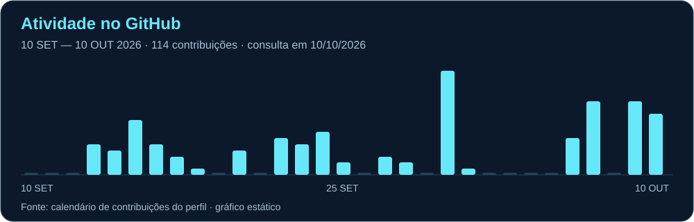

  

  

<strong>BACKEND · JAVA · SPRING BOOT · GO</strong> 
APIs, autenticação e persistência, conectadas a interfaces em React e Next.js.

  
  

Sou **Caio Fábio**. Desenvolvo aplicações web e APIs, com projetos de monitoramento ambiental, gestão de treinos e nutrição, além de estudos de backend com Java e Spring Boot. Meu portfólio reúne autenticação, persistência, testes e integração entre frontend e serviços.

## Projetos em destaque

### DSCatalog · Catálogo e administração

Catálogo com filtros, paginação e administração. O backend combina **OAuth2/JWT**, persistência com **JPA** e testes em camadas, integrado a uma interface em React.

**Java · Spring Boot · React · JPA · OAuth2/JWT**

[**Explorar o projeto →**](https://github.com/CaioFabio893/DSCatalog)

### Treinos e nutrição · API e aplicação web

API em **Go** e interface em **Next.js**, com responsabilidades separadas. O projeto utiliza **Firestore** para persistência, autenticação por perfil e serviços publicados no **Cloud Run**.

**Go · Next.js · TypeScript · Firestore · Cloud Run**

 
Interface de treinos — captura publicada na documentação do projeto.

[**Explorar o projeto →**](https://github.com/CaioFabio893/App-treino-nutricao)

## Outros projetos

<table>
<tr>
<td width="50%" valign="top">

### DSCommerce

API de e-commerce com produtos, categorias e pedidos. **Autorização por perfil** e modelagem relacional.

**Java · Spring Boot · JPA**

[**Repositório →**](https://github.com/CaioFabio893/DSCommerce)

</td>
<td width="50%" valign="top">

### Monitoramento ambiental

Registro de ninhos, visitas, transferências e eclosões em campo. **Offline-first**, mapas e exportação de relatórios.

**TypeScript · React · Firebase**

[**Repositório →**](https://github.com/CaioFabio893/app-tartaruga) · [**Aplicação →**](https://monitoramento-de-tartarugas.web.app)

</td>
</tr>
</table>

<strong>Ver a interface de monitoramento ambiental</strong>

*Dados fictícios do modo de treino.*

## Tecnologias e qualidade

<table width="100%">
<tr><td width="50%" align="center"><strong>Backend</strong>  </td><td width="50%" align="center"><strong>Frontend</strong>  </td></tr>
<tr><td align="center"><strong>Dados</strong>  </td><td align="center"><strong>Ferramentas e testes</strong>   JUnit · Mockito · testes de integração</td></tr>
</table>

## Atividade recente

Consulta do calendário do perfil em 10/10/2026. Este gráfico é estático; o calendário oficial abaixo dos projetos fixados continua atualizado pelo GitHub.
## Linguagens no portfólio

O gráfico reflete o volume de código público e está sujeito ao cache do serviço; não representa proficiência.

<strong>Mais estudos de backend</strong>

| Projeto | Objetivo | Tecnologias |
| --- | --- | --- |
| [Web Services com JPA](https://github.com/CaioFabio893/webServices-springboot-jpa) | CRUD, APIs REST e relacionamentos entre entidades | Java · Spring Boot · JPA · H2 |
| [Spring Boot com MongoDB](https://github.com/CaioFabio893/workshop-spring-boot-mongodb) | APIs e persistência NoSQL | Java · Spring Boot · MongoDB |

---

<strong>Vamos conversar sobre desenvolvimento?</strong> 
<a href="https://www.linkedin.com/in/caio-fabio-souza">LinkedIn</a> · <a href="https://github.com/CaioFabio893?tab=repositories">Todos os repositórios</a>

As tecnologias apresentadas estão presentes no portfólio. O uso de IA, quando aplicável, está registrado na documentação dos respectivos projetos.

