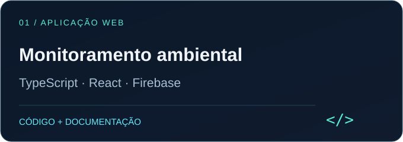
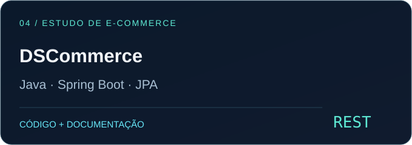
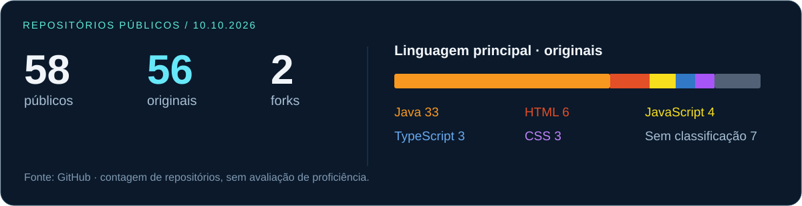

  

<strong>Java & Spring Boot · React & TypeScript · Go</strong> 
Aplicações web, APIs e soluções para problemas reais.

  
  

## Sobre mim

Sou **Caio Fábio**. Desenvolvo aplicações web e APIs, com projetos de monitoramento ambiental, gestão de treinos e nutrição, além de estudos de backend com Java e Spring Boot. Nos projetos, trabalho com autenticação, persistência, interfaces web e integração entre serviços.

## Projetos selecionados

<table>
<tr>
<td width="50%" valign="top">

Registro de ninhos, visitas, transferências e eclosões em campo. **Offline-first**, mapas e exportação de relatórios.

**[Repositório →](https://github.com/CaioFabio893/app-tartaruga)** · **[Aplicação →](https://monitoramento-de-tartarugas.web.app)**

</td>
<td width="50%" valign="top">

Gestão de alunos, programas, treinos e dietas. **Frontend e API separados**, autenticação e acesso por perfil.

**[Repositório →](https://github.com/CaioFabio893/App-treino-nutricao)**

</td>
</tr>
<tr>
<td width="50%" valign="top">

Catálogo com filtros, paginação e administração. **OAuth2/JWT**, persistência JPA e testes em camadas.

**[Repositório →](https://github.com/CaioFabio893/DSCatalog)**

</td>
<td width="50%" valign="top">

Estudo de API de e-commerce com produtos, categorias e pedidos. **Autorização por perfil** e modelagem relacional.

**[Repositório →](https://github.com/CaioFabio893/DSCommerce)**

</td>
</tr>
</table>

<strong>Ver os projetos em funcionamento — capturas de tela</strong>

### Monitoramento ambiental

*Dados fictícios do modo de treino.*

### Treinos e nutrição

*Captura da documentação; a interface pode variar conforme a versão.*

## Minha stack

<table>
<tr><td width="50%" align="center"><strong>Backend</strong>  </td><td width="50%" align="center"><strong>Frontend</strong>  </td></tr>
<tr><td align="center"><strong>Dados</strong>  </td><td align="center"><strong>Ferramentas e qualidade</strong>   JUnit · Mockito · testes de integração</td></tr>
</table>

## Portfólio em números

Retrato dos repositórios públicos em 10/10/2026. Linguagens por classificação principal do GitHub, excluindo forks; os números não medem proficiência e não são atualizados automaticamente.

<strong>Mais estudos de backend</strong>

| Projeto | Objetivo | Tecnologias |
| --- | --- | --- |
| [Web Services com JPA](https://github.com/CaioFabio893/webServices-springboot-jpa) | CRUD, APIs REST e relacionamentos entre entidades | Java · Spring Boot · JPA · H2 |
| [Spring Boot com MongoDB](https://github.com/CaioFabio893/workshop-spring-boot-mongodb) | APIs e persistência NoSQL | Java · Spring Boot · MongoDB |

---

<strong>Vamos conversar sobre desenvolvimento?</strong> 
<a href="https://www.linkedin.com/in/caio-fabio-souza">LinkedIn</a> · <a href="https://github.com/CaioFabio893?tab=repositories">Todos os repositórios</a>

As tecnologias apresentadas estão presentes no portfólio. O uso de IA, quando aplicável, está registrado na documentação dos respectivos projetos.
